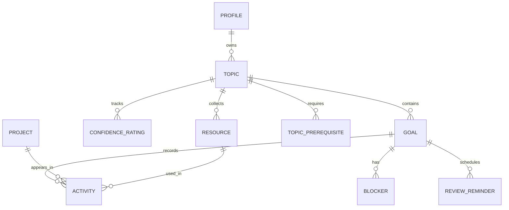

# Programming Study Tracker Plan

Last updated: November 4, 2026

## 1. Product summary

Programming Study Tracker is a personal web app for organizing programming study. The owner creates small goals under topics, records what they did each week, and links the projects they built. The name is a working title.

**The first version is complete when the owner can:**

- Create a topic and a goal with a clear definition of done.
- Open a goal, select what they did that week, and record the time spent.
- Add a project with a Git link.
- See active goals and this week's activity on a dashboard.
- Sign in with GitHub and use the app from a hosted URL. (This arrives last, in Phase 8; Phases 1 to 7 run locally.)

## 2. Scope

| Feature | What it does | Phase |
|---|---|---|
| Topics | Group goals by subject | 2 |
| Small goals | Break each topic into focused goals | 2 |
| Definition of done | Give each goal a clear finish line | 2 |
| Active goal limit | Keep the number of active goals small | 2 |
| Weekly log | Select what you did for a goal | 3 |
| Time tracking | Record the time spent on each activity | 3 |
| Projects | Save projects with Git links | 3 |
| Dashboard | Show active goals and weekly activity | 4 |
| Confidence rating | Rate each topic from 1 to 5 over time | 5 |
| Weekly review | Summarize the week across all goals | 5 |
| Stalled goal alerts | Flag goals with no recent activity | 5 |
| Activity calendar | Show study days in a yearly grid | 5 |
| GitHub integration | Show repository details automatically | 6 |
| Resource library | Save learning resources under each topic | 6 |
| Blockers list | Track problems and their solutions | 6 |
| Topic roadmap | Show which topics to learn first | 6 |
| Review reminders | Prompt reviews of completed goals | 7 |
| Portfolio page | Share selected goals and projects publicly | 7 |

**Out of scope:** weekly reflection prompts, AI quizzes and other AI features, team and social features, payments, and native mobile apps.

## 3. Architecture

| Part | Choice |
|---|---|
| Frontend | Next.js 16 App Router, TypeScript, Tailwind CSS, and shadcn/ui |
| Backend | Next.js Server Components, Server Actions, and Route Handlers |
| Database | Lakebase Postgres on Neon in production; PGlite (embedded Postgres) for local development and tests |
| Data access | Drizzle ORM and SQL migrations managed by drizzle-kit |
| Authentication | Neon Auth (managed Better Auth) with GitHub login, added in Phase 8 |
| External data | GitHub REST API |
| Hosting | Vercel |

The app has one owner, but every owned table has a `user_id` column, and every query and change is scoped to the signed-in user in server code. This keeps data isolated if sign-ups are ever opened by mistake and leaves room for multiple users later.

**Local first, Neon last.** Phases 1 to 7 run entirely on the owner's machine. The app uses an embedded PGlite database stored in `.data/` and a fixed local owner account that works only under `next dev`. Phase 8 connects the same schema and migrations to Neon, replaces the local owner with Neon Auth, and deploys to Vercel. The database driver is chosen in one module (`src/db/client.ts`), so app code does not change when Neon is connected.

**Why server-side scoping instead of RLS.** The browser never talks to the database. All reads and writes go through Server Components and Server Actions that use a server-only connection. Ownership is enforced in three layers: the verified user ID from the session, query helpers that always filter by that ID, and database constraints (composite foreign keys and triggers) that reject cross-owner references and rule violations.

## 4. Main user flow

1. Create a topic, such as React.
2. Create a goal with a definition of done.
3. Open the goal and choose **Log this week**.
4. Select what you did, describe it, and add the time spent.
5. If you built something, add the project and its Git link.
6. Save the log and see it on the goal page and dashboard.
7. Mark the goal complete when the definition of done is met.

## 5. Product rules

### Topics

- Topic names are unique for each user, ignoring capitalization.
- Topics are archived, not permanently deleted.
- A topic with active goals cannot be archived.
- Archived topics cannot receive new goals or have goals made active under them. Existing inactive goals remain available for editing.
- Topic names allow up to 100 characters; descriptions allow up to 5,000.

### Goals

- Each goal belongs to one topic.
- `definition_of_done` is required.
- Goal statuses are `planned`, `active`, `completed`, and `archived`.
- A goal starts as `planned`. The owner can make it active during creation if they are below their limit.
- The default active goal limit is 3. The owner can set a value from 1 to 10.
- If the limit is reached, the app blocks the change and lists the current active goals.
- Moving a goal to `active` sets `started_at` if it is empty.
- An active goal can move back to `planned`.
- Completing a goal requires confirmation and sets `completed_at`.
- A planned goal becomes active before it can be completed. Archived goals have no further status transitions in this phase.
- A completed goal can be reopened if the owner is below their limit. Reopening clears `completed_at`.
- Goals are archived, not permanently deleted.
- The active goal limit cannot be lowered below the current number of active goals. Move goals to `planned` first.
- Goal titles allow up to 160 characters, descriptions up to 5,000, and definitions of done up to 2,000.

### Weekly logs

There is no separate weekly log record. A weekly log is the list of dated activities in that week. This single source of data supports the goal history, time totals, weekly review, stalled alerts, and calendar.

- Only active goals can receive new activities.
- Weeks run from Monday through Sunday.
- Each activity has a date, which defaults to today. Future dates are not allowed.
- The log form supports selecting several activity types. Saving creates one activity row for each selected type.
- A description is required on each activity.
- Time is optional and is stored in minutes from 1 to 1,440.
- Totals include only activities with time recorded.
- Activities can be edited and deleted.

| Stored value | Label |
|---|---|
| `course` | Took a course |
| `reading` | Read docs or articles |
| `video` | Watched a video |
| `practice` | Practiced exercises |
| `project` | Built a project |
| `other` | Other |

### Projects

- A project needs a title and an `https` repository URL.
- Any Git host can be saved as a link. Automatic details are limited to public GitHub repositories.
- A `project` activity must link to a project. Other activity types must not.
- A project can be linked from activities on several goals.
- When a project is created from the log form, save the project first, then insert all activity rows in one bulk insert.

### Confidence ratings

- Ratings use a scale from 1 to 5.
- Every rating is saved, so the topic page can show the change over time.
- The current rating is the most recent saved rating.
- Completing a goal prompts the owner to update the topic's rating. The prompt can be skipped.

### Weekly review

The review is calculated from existing data and has its own page. It shows:

- Total recorded time
- Activities grouped by goal
- Projects worked on
- Blockers opened and solved
- Active goals with no activity that week

The review defaults to the current week and can show earlier weeks.

### Stalled goals

- A goal is stalled when it is active and has no activity for 14 days.
- If a goal has no activities, the 14 days start from `started_at`.
- Stalled goals appear on the dashboard and on the goal page.

### Activity calendar

- The calendar shows the last 12 months.
- Darker cells mean more activities on that day.
- Each day has a text label with its date, activity count, and recorded time.

### Topic roadmap

- A topic can list other topics as prerequisites.
- A prerequisite counts as finished when it has at least one completed goal.
- Unfinished prerequisites show a warning but do not block a goal.
- The app rejects a prerequisite that creates a loop.

### Review reminders

- Completing a goal creates a reminder due 7 days later.
- Finishing that reminder creates a second reminder due 30 days later.
- Reminders due today or earlier appear on the dashboard.
- Reopening a goal removes its unfinished reminders.
- Reminders appear inside the app. There are no emails in this plan.

### Portfolio

- The portfolio is off by default.
- Goals and projects are private until the owner marks them public.
- Only completed goals can be public.
- Slugs use lowercase letters, numbers, and hyphens.

## 6. Screens

| Route | Purpose | Phase |
|---|---|---|
| `/` | Redirect to the dashboard, or to the login page once login exists | 1, then 8 |
| `/login` | Sign in with GitHub | 8 |
| `/api/auth/[...path]` | Neon Auth handler, including the GitHub OAuth callback | 8 |
| `/dashboard` | Show active goals, weekly summary, alerts, reminders, and calendar | 1 (empty), 4, then 5 and 7 |
| `/topics` | List and create topics | 2 |
| `/topics/[id]` | Show a topic's goals, confidence history, and resources | 2, then 5 and 6 |
| `/goals` | List goals by status | 2 |
| `/goals/new` | Create a goal | 2 |
| `/goals/[id]` | Show the definition of done, activity history, projects, and blockers | 2, then 3 and 6 |
| `/goals/[id]/log` | Log this week's work | 3 |
| `/projects` | List projects | 3 |
| `/projects/[id]` | Show project details and linked goals | 3 |
| `/review` | Show the weekly review | 5 |
| `/roadmap` | Show topic prerequisites | 6 |
| `/settings` | Change the goal limit and portfolio settings | 2, then 7 |
| `/u/[slug]` | Show the public portfolio | 7 |

## 7. Data model



Create tables in the phase that needs them. All tables include `created_at`. Tables that can be edited also include `updated_at`, maintained by a shared trigger.

### Enums

- `goal_status`: `planned`, `active`, `completed`, `archived`
- `activity_type`: `course`, `reading`, `video`, `practice`, `project`, `other`
- `resource_type`: `course`, `docs`, `video`, `article`, `book`, `other`
- `resource_status`: `to_do`, `in_progress`, `finished`
- `blocker_status`: `open`, `solved`

### Tables

**`profiles` (Phase 1)**

- `user_id`: `text`, primary key. In local development it is the fixed local owner ID; from Phase 8 it is the Neon Auth user ID (`neon_auth.user.id`, read from the verified session). It is `text` because Neon Auth does not document the ID type, and there is no foreign key into the Neon-managed `neon_auth` schema.
- `display_name`: `text`
- `github_username`: `text`
- `active_goal_limit`: `smallint`, default 3, from 1 to 10

The app creates the profile on first use with an idempotent insert (`on conflict do nothing`) after it verifies the user. Every other owned table references `profiles.user_id`. Add these columns in Phase 7:

- `portfolio_enabled`: `boolean`, default false
- `portfolio_slug`: `text`, unique
- `portfolio_headline`: `text`

**`topics` (Phase 2)**

- `id`: `uuid`, primary key
- `user_id`: `uuid`, required
- `name`: `text`, required
- `description`: `text`
- `archived_at`: `timestamptz`

Add a unique index on `user_id` and `lower(name)`.

**`goals` (Phase 2)**

- `id`: `uuid`, primary key
- `user_id`: `uuid`, required
- `topic_id`: `uuid`, required
- `title`: `text`, required
- `description`: `text`
- `definition_of_done`: `text`, required
- `status`: `goal_status`, default `planned`
- `target_date`: `date`
- `started_at`: `timestamptz`
- `completed_at`: `timestamptz`
- `is_public`: `boolean`, default false, added in Phase 7

**`projects` (Phase 3)**

- `id`: `uuid`, primary key
- `user_id`: `uuid`, required
- `title`: `text`, required
- `description`: `text`
- `repo_url`: `text`, required
- `live_url`: `text`
- `is_public`: `boolean`, default false, added in Phase 7

Add these columns in Phase 6:

- `github_full_name`: `text`
- `github_description`: `text`
- `github_primary_language`: `text`
- `github_languages`: `jsonb`
- `github_last_commit_at`: `timestamptz`
- `github_synced_at`: `timestamptz`

**`activities` (Phase 3)**

- `id`: `uuid`, primary key
- `user_id`: `uuid`, required
- `goal_id`: `uuid`, required
- `type`: `activity_type`, required
- `description`: `text`, required
- `minutes`: `integer`, from 1 to 1,440
- `occurred_on`: `date`, required
- `project_id`: `uuid`
- `resource_id`: `uuid`, added in Phase 6

Add this check: `(type = 'project') = (project_id is not null)`.

Add indexes on `(user_id, occurred_on)` and `(goal_id, occurred_on desc)`.

**`confidence_ratings` (Phase 5)**

- `id`: `uuid`, primary key
- `user_id`: `uuid`, required
- `topic_id`: `uuid`, required
- `rating`: `smallint`, from 1 to 5
- `rated_at`: `timestamptz`, default now

**`resources` (Phase 6)**

- `id`: `uuid`, primary key
- `user_id`: `uuid`, required
- `topic_id`: `uuid`, required
- `title`: `text`, required
- `url`: `text`
- `type`: `resource_type`, required
- `status`: `resource_status`, default `to_do`

**`blockers` (Phase 6)**

- `id`: `uuid`, primary key
- `user_id`: `uuid`, required
- `goal_id`: `uuid`, required
- `title`: `text`, required
- `details`: `text`
- `status`: `blocker_status`, default `open`
- `solution`: `text`
- `solved_at`: `timestamptz`

A blocker must have a solution before it can be marked as solved.

**`topic_prerequisites` (Phase 6)**

- `user_id`: `uuid`, required
- `topic_id`: `uuid`, required
- `prerequisite_topic_id`: `uuid`, required

The primary key is `(topic_id, prerequisite_topic_id)`. A topic cannot be its own prerequisite.

**`review_reminders` (Phase 7)**

- `id`: `uuid`, primary key
- `user_id`: `uuid`, required
- `goal_id`: `uuid`, required
- `stage`: `smallint`, either 1 or 2
- `due_on`: `date`, required
- `completed_at`: `timestamptz`

Add a unique constraint on `(goal_id, stage)`.

### View

Create `goal_activity_summary` in Phase 5 with `security_invoker = true`. It returns `goal_id`, `last_activity_on`, `activity_count`, and `total_minutes`.

## 8. Security and privacy

- The database is reached only from server code (`server-only` modules). The browser never receives a database URL or credentials.
- Get the user ID only from the verified session through `requireUser()`. Never accept a user ID from the browser.
- Every owned-table query filters by that user ID, including the rows it updates or deletes. Tests prove that one user cannot read or change another user's rows through the query and action layer.
- Use composite foreign keys so a row can reference only rows with the same `user_id`.
- Enforce product rules that must not be bypassed (active goal limit, status transitions, archive rules) with database constraints and triggers as well as in server code.
- Check the signed-in user in every protected page, query, and Server Action. `proxy.ts` redirects are not enough on their own.
- **Local owner (Phases 1 to 7):** `requireUser()` returns a fixed local owner only when `NODE_ENV` is `development`, `LOCAL_OWNER_MODE=1`, and `VERCEL` is unset. In every other case it fails closed. It is removed from production paths in Phase 8.
- **Sign-up restriction (Phase 8):** Neon Auth lets anyone sign up by default and has no documented setting to turn sign-ups off. The app allows only the user IDs listed in the server-only `ALLOWED_USER_IDS` variable and treats everyone else as signed out.
- Render external links with `rel="noopener noreferrer"`.

The public portfolio uses one dedicated server query, `getPublicPortfolio(slug)`, in `src/features/portfolio/queries.ts`. It is the only code path that reads data without a signed-in user. It selects an explicit list of columns and returns data only when `portfolio_enabled` is true.

| Query returns | Query never returns |
|---|---|
| Display name, headline, and GitHub username | User ID |
| Public completed goals and their topic names | Planned, active, or private goals |
| Public projects, links, languages, and last commit date | Private projects |
| | Activities, time, blockers, confidence ratings, resources, and reminders |

## 9. GitHub integration

Phase 6 adds repository details for public GitHub repositories.

- Accept URLs in the form `https://github.com/{owner}/{repo}`, with or without `.git`.
- Save other `https` Git URLs as plain links.
- Send requests only to `api.github.com`, and only from the server.
- Use a server-only `GITHUB_TOKEN` with read-only access to public repositories.
- Do not store user OAuth tokens.

GitHub allows 60 unauthenticated requests per hour and 5,000 authenticated requests per hour.

| Request | Data |
|---|---|
| `GET /repos/{owner}/{repo}` | Full name, description, primary language |
| `GET /repos/{owner}/{repo}/languages` | Language breakdown |
| `GET /repos/{owner}/{repo}/commits?per_page=1` | Latest commit date |

- Sync after saving a GitHub project.
- Add a **Refresh** button.
- Treat saved details as stale after 24 hours.
- Save the project even if GitHub fails.
- Show a clear message for missing repositories, private repositories, and rate limits.

## 10. Owner setup

An agent cannot complete these account steps without the owner.

### Required for Phase 0

1. Install Node.js 22.13 or later (see `.nvmrc`).
2. Create an empty GitHub repository for the project.

No Docker or cloud account is needed for Phases 0 to 7.

### Required for Phase 1

1. Copy `.env.example` to `.env.local` and set `LOCAL_OWNER_MODE=1`.

### Required for Phase 6

1. Create a read-only GitHub token for public repositories.
2. Add it to `.env.local` as `GITHUB_TOKEN`, and to Vercel in Phase 8.

### Required for Phase 8

1. Create a Neon account and a project in an AWS region, then run `neon login` and `neon link` in the project folder.
2. Turn on Neon Auth for the project (`auth: true` in `neon.ts`, then `neon deploy`).
3. Create a GitHub OAuth app whose callback URL is `{NEON_AUTH_BASE_URL}/callback/github`, and add it with `neon neon-auth oauth-provider add --provider-id github ...` or in the Neon Console. Each Neon branch has its own Auth URL, so register a callback for each branch you sign in on.
4. Generate `NEON_AUTH_COOKIE_SECRET` with `openssl rand -base64 32`.
5. Import the GitHub repository into Vercel, add the production domain to Neon Auth trusted domains, and turn off **Allow Localhost** for the production branch.
6. Add the production environment variables to Vercel.
7. Sign in once, then put your user ID in `ALLOWED_USER_IDS`.

### Environment variables

| Name | Public | Needed from |
|---|---|---|
| `LOCAL_OWNER_MODE` | No (local only, never set on Vercel) | Phase 1 |
| `NEXT_PUBLIC_SITE_URL` | Yes | Phase 1 |
| `GITHUB_TOKEN` | No | Phase 6 |
| `DATABASE_URL` (pooled) | No | Phase 8 |
| `DATABASE_URL_UNPOOLED` (direct, migrations only) | No | Phase 8 |
| `NEON_AUTH_BASE_URL` | No | Phase 8 |
| `NEON_AUTH_COOKIE_SECRET` | No | Phase 8 |
| `ALLOWED_USER_IDS` | No | Phase 8 |

## 11. Build phases

### Phase 0: Project setup

`create-next-app` can reject a folder that already has files, and it creates its own `AGENTS.md` unless told not to. Create the app in a temporary folder so this `AGENTS.md` stays in place.

```bash
npx create-next-app@latest app-temp --typescript --tailwind --eslint --app --src-dir --import-alias "@/*" --use-npm --disable-git --no-agents-md
```

- [x] Confirm that the Phase 0 owner setup is complete. Node.js 22.15.0 is installed and the GitHub repository exists.
- [x] Run `git init`.
- [x] Run the command above. Used the cached `create-next-app` 16.4.4 CLI with `--skip-install`.
- [x] Move all generated files from `app-temp`, including hidden files, into the project root.
- [x] Remove `app-temp`.
- [x] Set the package name to `programming-study-tracker`.
- [x] Install Drizzle ORM, drizzle-kit, PGlite, and Playwright. Installed drizzle-orm 0.45.4, drizzle-kit 0.31.11, @electric-sql/pglite 0.5.15, @playwright/test 1.64.1, and server-only. The Neon packages are installed in Phase 8.
- [x] Set up shadcn/ui. Configured manually with theme variables, aliases, `cn`, and a shared Button.
- [x] Add the `typecheck`, `test`, and `test:e2e` scripts.
- [x] Add `.env.example`, and make sure Git tracks it while ignoring real `.env` files.
- [x] Add the folders listed in `AGENTS.md`.
- [x] Add `CLAUDE.md` containing `@AGENTS.md`.
- [x] Commit the project and push it to GitHub.

**Done when:** The starter app runs, and lint, type checks, tests, and the production build pass.

**Verified November 4, 2026:** `npm ci`, `npm run lint`, `npm run typecheck`, `npm test`, and `npm run build` pass.

### Phase 1: Local foundation

No cloud account or Docker is needed.

- [x] Add the Drizzle schema in `src/db/schema.ts` and the server-only database client in `src/db/client.ts` (PGlite locally; Neon is added in Phase 8).
- [x] Generate migrations with drizzle-kit. Add the shared `updated_at` trigger in a custom SQL migration.
- [x] Add a migration script (`npm run db:migrate`) and a reset script for the local database (`npm run db:reset`). The dev server also applies pending migrations when it first opens the database.
- [x] Create `profiles`.
- [x] Add `requireUser()` in `src/lib/auth/` with the guarded local owner, and ensure the profile exists on first use.
- [x] Add database test helpers that run migrations on a fresh in-memory PGlite database.
- [x] Add the main layout with links to the app's main sections, and an empty `/dashboard`. The navigation lists only built sections; each phase adds its own.
- [x] Make `/` redirect to `/dashboard`.
- [x] Configure Playwright with a smoke test against `next dev` in local owner mode.

**Done when:** `npm run dev` opens an empty dashboard as the local owner, the local owner fails closed in a production build, and the database tests pass.

**Verified November 4, 2026:** Lint, type checking, 46 unit/component/database tests, and the production build pass. `npm run db:reset` and `npm run db:migrate` work, and re-running migrations is a no-op. Database tests run on in-memory PGlite and cover the profile defaults, the limit check, empty IDs, and the `updated_at` trigger. Playwright passes 8 tests: the dashboard, navigation state, skip link, and login redirect at desktop and mobile (Pixel 7) widths with no horizontal scroll, plus a production build with `LOCAL_OWNER_MODE=1` set that still redirects to `/login`. `requireUser()` calls `connection()`, so user checks never run during prerendering. Until Phase 8, `/login` shows that sign-in is unavailable.

**Superseded preparation (November 4, 2026):** Codex prepared Supabase migrations, pgTAP tests, Supabase config validation, a Supabase test-user fixture, and Supabase CLI scripts. None of them were applied. They were removed from the working tree in this phase and remain in Git history at commit `edfa92c`. The login panel and sign-out form components are kept for Phase 8.

### Phase 2: Topics and goals

- [ ] Create `topics`, `goals`, the `goal_status` enum, and their indexes, with the composite topic ownership foreign key.
- [ ] Port the goal and topic guard triggers (status transitions, timestamps, archive rules, and the active goal limit with profile-row locking) to a custom SQL migration.
- [ ] Build topic creation, editing, and archiving.
- [ ] Build goal creation and editing with a required definition of done.
- [ ] Build the goal status changes from section 5.
- [ ] Add the active goal limit to `/settings`, enforced by the database trigger.
- [ ] Build the topic list, topic page, goal list, and goal page.
- [ ] Add unit, ownership, database rule, and component tests.

**Done when:** The owner can manage topics and goals, and the active goal limit cannot be bypassed through any Server Action or direct database write.

**Prepared November 4, 2026:** The topic create/edit/archive forms, goal create/edit/status forms, active-limit settings form, topic and goal lists and detail components, input schemas, status rules, and calendar-date formatting exist with 56 passing tests. They take action props and presentation models, so they work with any data layer. The rules in the superseded Supabase migration (`supabase/migrations/20261104173000_create_topics_and_goals.sql`, in Git history at commit `edfa92c`) are the reference for the trigger port.

### Phase 3: Weekly logs and projects

- [ ] Create `projects`, `activities`, the `activity_type` enum, and indexes.
- [ ] Add date helpers for Monday-to-Sunday weeks, with tests.
- [ ] Build `/goals/[id]/log`.
- [ ] Support several activity types in one save.
- [ ] Support choosing an existing project or adding a new one with a Git link.
- [ ] Show activity history on the goal page, grouped by week, with weekly time totals.
- [ ] Support editing and deleting activities.
- [ ] Build the project list and project page.
- [ ] Add `https`-only URL validation.
- [ ] Add unit, ownership, and component tests.

**Done when:** The owner can open an active goal, select what they did, add time, attach a project, and see it in that week's history.

### Phase 4: Dashboard

- [ ] Build `/dashboard` with active goals, their latest activity, and **Log this week** links.
- [ ] Add this week's total time and activity count.
- [ ] Add recent projects.
- [ ] Add loading, empty, and error states across the app.
- [ ] Test the main screens at desktop and mobile widths.
- [ ] Add a Playwright test for the main user flow.

**Done when:** The full main user flow from section 4 works locally and is covered by a Playwright test.

### Phase 5: Progress and consistency

- [ ] Create `confidence_ratings` and `goal_activity_summary`.
- [ ] Add confidence ratings and history to the topic page.
- [ ] Prompt for a rating when a goal is completed.
- [ ] Build `/review`, with support for earlier weeks.
- [ ] Add stalled goal alerts to the dashboard and goal page.
- [ ] Add the activity calendar to the dashboard.
- [ ] Add tests for stalled goal rules and weekly totals.

**Done when:** The owner can see confidence changes, review any week, spot stalled goals, and view their study days.

### Phase 6: GitHub and learning support

- [ ] Add the GitHub project columns.
- [ ] Add a tested GitHub URL parser and server-side API client.
- [ ] Sync repository details after saving, and add **Refresh**.
- [ ] Create `resources` and `activities.resource_id`.
- [ ] Add the resource library to topic pages.
- [ ] Let an activity link to a resource.
- [ ] Create `blockers` and add them to goal pages.
- [ ] Include blockers in the weekly review.
- [ ] Create `topic_prerequisites`.
- [ ] Build `/roadmap` with prerequisite warnings and loop prevention.
- [ ] Add unit, ownership, and component tests.

**Done when:** Public GitHub repositories show their details, and the owner can manage resources, blockers, and topic prerequisites.

### Phase 7: Reviews and portfolio

- [ ] Create `review_reminders`.
- [ ] Create reminders when goals are completed.
- [ ] Show due reminders on the dashboard and let the owner finish them.
- [ ] Remove unfinished reminders when a goal is reopened.
- [ ] Add portfolio settings and `is_public` controls.
- [ ] Add `getPublicPortfolio(slug)` with an explicit column list.
- [ ] Build `/u/[slug]`.
- [ ] Add a Playwright test proving that private data does not appear on the portfolio.
- [ ] Complete a final accessibility check.

**Done when:** Reminders work, and a visitor can see only the content the owner chose to make public.

### Phase 8: Neon, login, and deployment

- [ ] Complete the Phase 8 owner setup.
- [ ] Install `@neon/auth`, `@neondatabase/serverless`, and `@neon/config`, and add `neon.ts` with `auth: true`.
- [ ] Add the Neon driver to `src/db/client.ts` when `DATABASE_URL` is set. Use a driver that supports transactions.
- [ ] Apply all migrations to a Neon development branch with `DATABASE_URL_UNPOOLED`, then run the database tests against it.
- [ ] Add the Neon Auth server instance, the `/api/auth/[...path]` handler, and the browser auth client.
- [ ] Add `src/proxy.ts` with `auth.middleware()` to redirect signed-out visitors, with `/login` and `/u/[slug]` public.
- [ ] Build `/login` with GitHub sign-in, and sign-out.
- [ ] Switch `requireUser()` to Neon Auth sessions with the `ALLOWED_USER_IDS` check. Keep the local owner limited to `next dev` without `DATABASE_URL`.
- [ ] Get approval, apply migrations to the production branch, and deploy to Vercel.
- [ ] Test sign-in, the sign-up restriction, and the main user flow in production.
- [ ] Update `README.md` with the final setup and deployment steps.

**Done when:** The first version is live and meets the criteria in section 1.

## 12. Testing

- **Unit tests:** Week dates, status rules, active limit, stalled goals, reminder dates, and GitHub URL parsing.
- **Component tests:** Goal forms, the log form, and empty and error states.
- **Database tests:** Run with Vitest against a fresh in-memory PGlite database that has all migrations applied. They cover constraints, triggers, composite foreign keys, and ownership: one user cannot read or change another user's rows through the query and action layer. In Phase 8, the same tests also run against a Neon development branch.
- **End-to-end tests:** Create a topic and goal, log an activity, add a project, and see it on the dashboard. Phase 8 adds sign-in and sign-up restriction checks.

End-to-end tests should not depend on GitHub's login page. Locally, they run against `next dev` in local owner mode.

## 13. Free plan limits

Limits can change. Check them again before launch in Phase 8.

**Neon Free**

Neon compute scales to zero when the app is idle and wakes on the next request, so the first request after a quiet period is slower. Storage is still counted while compute is idle. Check the current Neon Free plan limits for storage, compute hours, and Neon Auth users before Phase 8.

**Vercel Hobby**

- Free for personal, non-commercial use

Move to a paid plan before charging for the app or using it commercially.

## 14. Decision log

| Date | Decision | Reason |
|---|---|---|
| 2026-11-04 | Use Next.js, Supabase, and Vercel | The owner chose this stack after comparing the alternatives (replaced by the Neon decisions below) |
| 2026-11-04 | Remove weekly reflection and AI quiz | The owner does not want these features |
| 2026-11-04 | Store dated activities instead of weekly records | One table supports history, totals, reviews, alerts, and the calendar |
| 2026-11-04 | Keep reminders and alerts inside the app | This avoids a scheduled job and an email service |
| 2026-11-04 | Use one public database function for the portfolio | Private tables stay closed to public visitors (replaced by a dedicated server query below) |
| 2026-11-04 | Use a server token for GitHub data | Public repository details do not require storing user OAuth tokens |
| 2026-11-04 | Use Node.js 22.15.0 for the initial development setup | The selected Vitest and jsdom versions need newer Node.js than the framework's 20.9 minimum; this version is already installed |
| 2026-11-04 | Use the supported Next.js Webpack production build and Tailwind PostCSS integration | The agent sandbox blocks Turbopack's worker port; the Webpack production build passes |
| 2026-11-04 | Use system fonts for the initial starter | The app can build without downloading fonts in a network-restricted environment |
| 2026-11-04 | Keep `profiles.id` and add a constrained `user_id` | This preserves the planned Auth primary key while meeting the owner-column and RLS rules in `AGENTS.md` (replaced: `profiles.user_id` is now the primary key) |
| 2026-11-04 | Create browser test users through local Auth, with no application login bypass | The test-only helper rejects hosted targets, Vercel, and production execution before issuing a request (replaced by the local owner below) |
| 2026-11-04 | Serialize active-goal changes through a profile row write | Concurrent activations and limit changes must share a lock; stale repeatable-read writers must retry |
| 2026-11-04 | Use explicit goal transitions and block a limit below the active count | Planned goals activate before completion; archived goals are final in this phase; existing goals are never silently moved |
| 2026-11-04 | Keep archived topics closed to new and reactivated goals | Archiving preserves existing study history while removing the topic from active work |
| 2026-11-04 | Bound topic/goal text inputs and validate calendar dates | The form schemas and database constraints reject empty required text and oversized input |
| 2026-11-04 | Replace Supabase with Neon (Lakebase Postgres and Neon Auth) | Owner decision. No Supabase code or migration had been applied, so switching was cheap. Neon needs no Docker, and its compute wakes on its own instead of pausing |
| 2026-11-04 | Build Phases 1 to 7 locally and connect Neon in Phase 8 | Owner decision. Work can continue without cloud accounts; the owner completes account setup at the end |
| 2026-11-04 | Use Drizzle ORM with drizzle-kit SQL migrations | Typed queries and inferred types replace generated Supabase types; the same migrations run on PGlite and Neon |
| 2026-11-04 | Use PGlite as the local and test database | It is real Postgres in Node with no Docker, so triggers, constraints, and SQL migrations behave as they will on Neon |
| 2026-11-04 | Enforce ownership in server code and database constraints instead of RLS | The browser never queries the database; all access is server-side with a verified user ID, composite foreign keys, and triggers |
| 2026-11-04 | Use a dev-only local owner until Phase 8 | It requires `next dev`, `LOCAL_OWNER_MODE=1`, and no `VERCEL`, and it fails closed everywhere else |
| 2026-11-04 | Store user IDs as `text` with no foreign key into `neon_auth` | Neon Auth does not document its user ID type or app foreign keys, and Neon manages that schema |
| 2026-11-04 | Restrict sign-ups with a server-side `ALLOWED_USER_IDS` check | Neon Auth has no documented setting to turn off sign-ups |
| 2026-11-04 | Serve the public portfolio from one server query with an explicit column list | Without RLS, a single reviewed code path keeps private data out of the public page |

## 15. Ideas for later

Do not build these unless the owner approves them and this plan is updated.

- Email reminders, which would require a daily scheduled job and an email service
- Automatic details for private GitHub repositories
