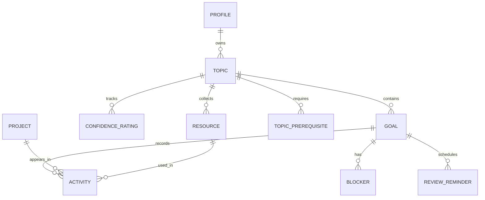

# Programming Study Tracker Plan

Last updated: November 4, 2026

## 1. Product summary

Programming Study Tracker is a personal web app for organizing programming study. The owner creates small goals under topics, records what they did each week, and links the projects they built. The name is a working title.

**The first version is complete when the owner can:**

- Create a topic and a goal with a clear definition of done.
- Open a goal, select what they did that week, and record the time spent.
- Add a project with a Git link.
- See active goals and this week's activity on a dashboard.
- Sign in with GitHub and use the app from a hosted URL.

## 2. Scope

| Feature | What it does | Phase |
|---|---|---|
| Topics | Group goals by subject | 2 |
| Small goals | Break each topic into focused goals | 2 |
| Definition of done | Give each goal a clear finish line | 2 |
| Active goal limit | Keep the number of active goals small | 2 |
| Weekly log | Select what you did for a goal | 3 |
| Time tracking | Record the time spent on each activity | 3 |
| Projects | Save projects with Git links | 3 |
| Dashboard | Show active goals and weekly activity | 4 |
| Confidence rating | Rate each topic from 1 to 5 over time | 5 |
| Weekly review | Summarize the week across all goals | 5 |
| Stalled goal alerts | Flag goals with no recent activity | 5 |
| Activity calendar | Show study days in a yearly grid | 5 |
| GitHub integration | Show repository details automatically | 6 |
| Resource library | Save learning resources under each topic | 6 |
| Blockers list | Track problems and their solutions | 6 |
| Topic roadmap | Show which topics to learn first | 6 |
| Review reminders | Prompt reviews of completed goals | 7 |
| Portfolio page | Share selected goals and projects publicly | 7 |

**Out of scope:** weekly reflection prompts, AI quizzes and other AI features, team and social features, payments, and native mobile apps.

## 3. Architecture

| Part | Choice |
|---|---|
| Frontend | Next.js 16 App Router, TypeScript, Tailwind CSS, and shadcn/ui |
| Backend | Next.js Server Components, Server Actions, and Route Handlers |
| Database | PostgreSQL on Supabase |
| Authentication | Supabase Auth with GitHub login |
| External data | GitHub REST API |
| Hosting | Vercel |

The app has one owner, but the database uses `user_id` and RLS on every table. This keeps data isolated if sign-ups are ever opened by mistake and leaves room for multiple users later.

## 4. Main user flow

1. Create a topic, such as React.
2. Create a goal with a definition of done.
3. Open the goal and choose **Log this week**.
4. Select what you did, describe it, and add the time spent.
5. If you built something, add the project and its Git link.
6. Save the log and see it on the goal page and dashboard.
7. Mark the goal complete when the definition of done is met.

## 5. Product rules

### Topics

- Topic names are unique for each user, ignoring capitalization.
- Topics are archived, not permanently deleted.
- A topic with active goals cannot be archived.

### Goals

- Each goal belongs to one topic.
- `definition_of_done` is required.
- Goal statuses are `planned`, `active`, `completed`, and `archived`.
- A goal starts as `planned`. The owner can make it active during creation if they are below their limit.
- The default active goal limit is 3. The owner can set a value from 1 to 10.
- If the limit is reached, the app blocks the change and lists the current active goals.
- Moving a goal to `active` sets `started_at` if it is empty.
- An active goal can move back to `planned`.
- Completing a goal requires confirmation and sets `completed_at`.
- A completed goal can be reopened if the owner is below their limit. Reopening clears `completed_at`.
- Goals are archived, not permanently deleted.

### Weekly logs

There is no separate weekly log record. A weekly log is the list of dated activities in that week. This single source of data supports the goal history, time totals, weekly review, stalled alerts, and calendar.

- Only active goals can receive new activities.
- Weeks run from Monday through Sunday.
- Each activity has a date, which defaults to today. Future dates are not allowed.
- The log form supports selecting several activity types. Saving creates one activity row for each selected type.
- A description is required on each activity.
- Time is optional and is stored in minutes from 1 to 1,440.
- Totals include only activities with time recorded.
- Activities can be edited and deleted.

| Stored value | Label |
|---|---|
| `course` | Took a course |
| `reading` | Read docs or articles |
| `video` | Watched a video |
| `practice` | Practiced exercises |
| `project` | Built a project |
| `other` | Other |

### Projects

- A project needs a title and an `https` repository URL.
- Any Git host can be saved as a link. Automatic details are limited to public GitHub repositories.
- A `project` activity must link to a project. Other activity types must not.
- A project can be linked from activities on several goals.
- When a project is created from the log form, save the project first, then insert all activity rows in one bulk insert.

### Confidence ratings

- Ratings use a scale from 1 to 5.
- Every rating is saved, so the topic page can show the change over time.
- The current rating is the most recent saved rating.
- Completing a goal prompts the owner to update the topic's rating. The prompt can be skipped.

### Weekly review

The review is calculated from existing data and has its own page. It shows:

- Total recorded time
- Activities grouped by goal
- Projects worked on
- Blockers opened and solved
- Active goals with no activity that week

The review defaults to the current week and can show earlier weeks.

### Stalled goals

- A goal is stalled when it is active and has no activity for 14 days.
- If a goal has no activities, the 14 days start from `started_at`.
- Stalled goals appear on the dashboard and on the goal page.

### Activity calendar

- The calendar shows the last 12 months.
- Darker cells mean more activities on that day.
- Each day has a text label with its date, activity count, and recorded time.

### Topic roadmap

- A topic can list other topics as prerequisites.
- A prerequisite counts as finished when it has at least one completed goal.
- Unfinished prerequisites show a warning but do not block a goal.
- The app rejects a prerequisite that creates a loop.

### Review reminders

- Completing a goal creates a reminder due 7 days later.
- Finishing that reminder creates a second reminder due 30 days later.
- Reminders due today or earlier appear on the dashboard.
- Reopening a goal removes its unfinished reminders.
- Reminders appear inside the app. There are no emails in this plan.

### Portfolio

- The portfolio is off by default.
- Goals and projects are private until the owner marks them public.
- Only completed goals can be public.
- Slugs use lowercase letters, numbers, and hyphens.

## 6. Screens

| Route | Purpose | Phase |
|---|---|---|
| `/` | Redirect to the dashboard or login page | 1 |
| `/login` | Sign in with GitHub | 1 |
| `/auth/callback` | Finish the sign-in process | 1 |
| `/dashboard` | Show active goals, weekly summary, alerts, reminders, and calendar | 4, then 5 and 7 |
| `/topics` | List and create topics | 2 |
| `/topics/[id]` | Show a topic's goals, confidence history, and resources | 2, then 5 and 6 |
| `/goals` | List goals by status | 2 |
| `/goals/new` | Create a goal | 2 |
| `/goals/[id]` | Show the definition of done, activity history, projects, and blockers | 2, then 3 and 6 |
| `/goals/[id]/log` | Log this week's work | 3 |
| `/projects` | List projects | 3 |
| `/projects/[id]` | Show project details and linked goals | 3 |
| `/review` | Show the weekly review | 5 |
| `/roadmap` | Show topic prerequisites | 6 |
| `/settings` | Change the goal limit and portfolio settings | 2, then 7 |
| `/u/[slug]` | Show the public portfolio | 7 |

## 7. Data model



Create tables in the phase that needs them. All tables include `created_at`. Tables that can be edited also include `updated_at`, maintained by a shared trigger.

### Enums

- `goal_status`: `planned`, `active`, `completed`, `archived`
- `activity_type`: `course`, `reading`, `video`, `practice`, `project`, `other`
- `resource_type`: `course`, `docs`, `video`, `article`, `book`, `other`
- `resource_status`: `to_do`, `in_progress`, `finished`
- `blocker_status`: `open`, `solved`

### Tables

**`profiles` (Phase 1)**

- `id`: `uuid`, primary key, references `auth.users`
- `user_id`: `uuid`, unique and required, references `auth.users`; a check requires `user_id = id` so owner-only RLS follows `AGENTS.md`
- `display_name`: `text`
- `github_username`: `text`
- `active_goal_limit`: `smallint`, default 3, from 1 to 10

Add a trigger that creates a profile for each new user. Add these columns in Phase 7:

- `portfolio_enabled`: `boolean`, default false
- `portfolio_slug`: `text`, unique
- `portfolio_headline`: `text`

**`topics` (Phase 2)**

- `id`: `uuid`, primary key
- `user_id`: `uuid`, required
- `name`: `text`, required
- `description`: `text`
- `archived_at`: `timestamptz`

Add a unique index on `user_id` and `lower(name)`.

**`goals` (Phase 2)**

- `id`: `uuid`, primary key
- `user_id`: `uuid`, required
- `topic_id`: `uuid`, required
- `title`: `text`, required
- `description`: `text`
- `definition_of_done`: `text`, required
- `status`: `goal_status`, default `planned`
- `target_date`: `date`
- `started_at`: `timestamptz`
- `completed_at`: `timestamptz`
- `is_public`: `boolean`, default false, added in Phase 7

**`projects` (Phase 3)**

- `id`: `uuid`, primary key
- `user_id`: `uuid`, required
- `title`: `text`, required
- `description`: `text`
- `repo_url`: `text`, required
- `live_url`: `text`
- `is_public`: `boolean`, default false, added in Phase 7

Add these columns in Phase 6:

- `github_full_name`: `text`
- `github_description`: `text`
- `github_primary_language`: `text`
- `github_languages`: `jsonb`
- `github_last_commit_at`: `timestamptz`
- `github_synced_at`: `timestamptz`

**`activities` (Phase 3)**

- `id`: `uuid`, primary key
- `user_id`: `uuid`, required
- `goal_id`: `uuid`, required
- `type`: `activity_type`, required
- `description`: `text`, required
- `minutes`: `integer`, from 1 to 1,440
- `occurred_on`: `date`, required
- `project_id`: `uuid`
- `resource_id`: `uuid`, added in Phase 6

Add this check: `(type = 'project') = (project_id is not null)`.

Add indexes on `(user_id, occurred_on)` and `(goal_id, occurred_on desc)`.

**`confidence_ratings` (Phase 5)**

- `id`: `uuid`, primary key
- `user_id`: `uuid`, required
- `topic_id`: `uuid`, required
- `rating`: `smallint`, from 1 to 5
- `rated_at`: `timestamptz`, default now

**`resources` (Phase 6)**

- `id`: `uuid`, primary key
- `user_id`: `uuid`, required
- `topic_id`: `uuid`, required
- `title`: `text`, required
- `url`: `text`
- `type`: `resource_type`, required
- `status`: `resource_status`, default `to_do`

**`blockers` (Phase 6)**

- `id`: `uuid`, primary key
- `user_id`: `uuid`, required
- `goal_id`: `uuid`, required
- `title`: `text`, required
- `details`: `text`
- `status`: `blocker_status`, default `open`
- `solution`: `text`
- `solved_at`: `timestamptz`

A blocker must have a solution before it can be marked as solved.

**`topic_prerequisites` (Phase 6)**

- `user_id`: `uuid`, required
- `topic_id`: `uuid`, required
- `prerequisite_topic_id`: `uuid`, required

The primary key is `(topic_id, prerequisite_topic_id)`. A topic cannot be its own prerequisite.

**`review_reminders` (Phase 7)**

- `id`: `uuid`, primary key
- `user_id`: `uuid`, required
- `goal_id`: `uuid`, required
- `stage`: `smallint`, either 1 or 2
- `due_on`: `date`, required
- `completed_at`: `timestamptz`

Add a unique constraint on `(goal_id, stage)`.

### View

Create `goal_activity_summary` in Phase 5 with `security_invoker = true`. It returns `goal_id`, `last_activity_on`, `activity_count`, and `total_minutes`.

## 8. Security and privacy

- Enable RLS on every table with owner-only policies.
- Do not add public RLS policies to private tables.
- Use composite foreign keys so a row can reference only rows with the same `user_id`.
- Check the signed-in user in every protected page, query, and Server Action.
- Turn off new sign-ups after the owner's account is created.
- Render external links with `rel="noopener noreferrer"`.

The public portfolio uses one database function:

`get_public_portfolio(slug text)`

This `SECURITY DEFINER` function has a fixed `search_path`, and only this function is available to public visitors. It returns data only when `portfolio_enabled` is true.

| Function returns | Function never returns |
|---|---|
| Display name, headline, and GitHub username | User ID |
| Public completed goals and their topic names | Planned, active, or private goals |
| Public projects, links, languages, and last commit date | Private projects |
| | Activities, time, blockers, confidence ratings, resources, and reminders |

## 9. GitHub integration

Phase 6 adds repository details for public GitHub repositories.

- Accept URLs in the form `https://github.com/{owner}/{repo}`, with or without `.git`.
- Save other `https` Git URLs as plain links.
- Send requests only to `api.github.com`, and only from the server.
- Use a server-only `GITHUB_TOKEN` with read-only access to public repositories.
- Do not store user OAuth tokens.

GitHub allows 60 unauthenticated requests per hour and 5,000 authenticated requests per hour.

| Request | Data |
|---|---|
| `GET /repos/{owner}/{repo}` | Full name, description, primary language |
| `GET /repos/{owner}/{repo}/languages` | Language breakdown |
| `GET /repos/{owner}/{repo}/commits?per_page=1` | Latest commit date |

- Sync after saving a GitHub project.
- Add a **Refresh** button.
- Treat saved details as stale after 24 hours.
- Save the project even if GitHub fails.
- Show a clear message for missing repositories, private repositories, and rate limits.

## 10. Owner setup

An agent cannot complete these account steps without the owner.

### Required for Phase 0

1. Install Node.js 20.9 or later.
2. Install Docker or a compatible runtime for local Supabase.
3. Create an empty GitHub repository for the project.

### Required for Phase 1

1. Create a GitHub OAuth app for local development.
2. Use `http://127.0.0.1:54321/auth/v1/callback` as its callback URL.
3. Add its client ID and secret to the local Supabase setup without committing them.

### Required for Phase 4

1. Create a hosted Supabase project.
2. Create a second GitHub OAuth app using the callback URL shown by Supabase.
3. Turn on GitHub login in Supabase and add the OAuth app's credentials.
4. Set the production site URL and add `/auth/callback` to the allowed redirect URLs.
5. Import the GitHub repository into Vercel.
6. Add the production environment variables.
7. Sign in once, then turn off new sign-ups in Supabase Auth.

### Required for Phase 6

1. Create a read-only GitHub token for public repositories.
2. Add it to `.env.local` and Vercel as `GITHUB_TOKEN`.

### Environment variables

| Name | Public | Needed from |
|---|---|---|
| `NEXT_PUBLIC_SUPABASE_URL` | Yes | Phase 1 |
| `NEXT_PUBLIC_SUPABASE_PUBLISHABLE_KEY` | Yes | Phase 1 |
| `NEXT_PUBLIC_SITE_URL` | Yes | Phase 1 |
| `GITHUB_TOKEN` | No | Phase 6 |

## 11. Build phases

### Phase 0: Project setup

`create-next-app` can reject a folder that already has files, and it creates its own `AGENTS.md` unless told not to. Create the app in a temporary folder so this `AGENTS.md` stays in place.

```bash
npx create-next-app@latest app-temp --typescript --tailwind --eslint --app --src-dir --import-alias "@/*" --use-npm --disable-git --no-agents-md
```

- [ ] Confirm that the Phase 0 owner setup is complete.
- [x] Run `git init`.
- [x] Run the command above. Used the cached `create-next-app` 16.4.4 CLI with `--skip-install`; installed available packages separately because registry access is blocked.
- [x] Move all generated files from `app-temp`, including hidden files, into the project root.
- [x] Remove `app-temp`.
- [x] Set the package name to `programming-study-tracker`.
- [ ] Install Zod, Supabase packages, Supabase CLI, Vitest, Testing Library, and Playwright.
- [x] Set up shadcn/ui. Configured manually with theme variables, aliases, `cn`, and a shared Button; verified by the component test and production build.
- [ ] Add the `typecheck`, `test`, and `test:e2e` scripts.
- [x] Add `.env.example`, and make sure Git tracks it while ignoring real `.env` files.
- [x] Add the folders listed in `AGENTS.md`.
- [ ] If Claude Code will be used, add `CLAUDE.md` containing `@AGENTS.md`.
- [ ] Commit the project and push it to GitHub.

**Done when:** The starter app runs, and lint, type checks, tests, and the production build pass.

**Verified November 4, 2026:** A clean `npm ci` from the lockfile succeeds using the local cache. `npm run lint`, `npm run typecheck`, `npm test` (one keyboard navigation smoke test), and `npm run build` pass. Node.js 22.15.0 is installed, and the owner initialized Git, added `https://github.com/gabriel-wargha/programming-study-tracker.git`, and pushed the first scaffold commit. `.env.example` is tracked; real `.env` files are ignored. The project folders exist; database types will be generated with the first schema in Phase 1.

**Still pending:** Supabase packages, Supabase CLI, and Playwright cannot be installed because registry access is blocked and these packages are absent from the local cache. `typecheck` and `test` work; `test:e2e` is defined but fails until Playwright is installed and configured. Docker is installed, but the session cannot access its socket. The development server cannot bind a local port, and browser control permissions are unavailable, so running-app and desktop/mobile browser verification remain open. The remaining changes need a commit and push; the commit attempt was blocked from writing `.git/index.lock`. `CLAUDE.md` is conditional and has not been added because Claude Code use has not been requested. See `README.md` for the remaining installation commands.

### Phase 1: Login and foundation

- [ ] Run `npx supabase init` and `npx supabase start`.
- [ ] Set up GitHub login for local Supabase.
- [ ] Add the browser, server, and proxy Supabase clients using the current Supabase guide.
- [ ] Add `src/proxy.ts` to refresh sessions and redirect signed-out users.
- [ ] Build `/login`, `/auth/callback`, and sign-out.
- [ ] Create `profiles`, its RLS policies, and the new-user trigger.
- [ ] Generate database types.
- [ ] Add the main layout with links to the app's main sections.
- [ ] Add RLS tests.
- [ ] Add a local-only test user for Playwright. It must never work in production.

**Done when:** The owner can sign in with GitHub, reach an empty dashboard, and sign out. Signed-out visitors are redirected to `/login`.

**Prepared November 4, 2026:** Login and sign-out form components with pending and error states; public Supabase configuration validation; a profiles migration with owner-only read/update policies, restricted column grants, a new-user trigger, and a shared update timestamp trigger; 16 pgTAP assertions; a guarded local test-user fixture; and `npm run db:types` for generating types without erasing an existing type file on failure. The auth components are not yet mounted as routes. No Phase 1 task is marked complete until its integration checks pass.

**Validation:** Lint, type checking, all 24 unit/component tests, and the production build pass. Attempts to run `supabase db reset`, `supabase test db`, database type generation, and Playwright could not proceed because their tools are not installed. The local test-user fixture is unit-tested with mocked Auth responses; a real test user has not been created.

**Blocked prerequisites:** The Supabase SDKs and CLI and Playwright are not installed. The attempted SDK installation failed because npm registry DNS is unavailable; the database reset could not run because the CLI is not installed or cached. The session also cannot access Docker's socket. Browser/server/proxy clients, OAuth routes, protected layout, and generated database types are still pending. The owner has been asked to install the packages, initialize/start local Supabase, and create the local GitHub OAuth app. No schema has been applied or database types generated.

### Phase 2: Topics and goals

- [ ] Create `topics`, `goals`, their enums, RLS policies, and indexes.
- [ ] Build topic creation, editing, and archiving.
- [ ] Build goal creation and editing with a required definition of done.
- [ ] Build the goal status changes from section 5.
- [ ] Add the active goal limit to `/settings` and enforce it with a database trigger.
- [ ] Build the topic list, topic page, goal list, and goal page.
- [ ] Add unit, RLS, and component tests.

**Done when:** The owner can manage topics and goals, and the active goal limit cannot be bypassed from the browser.

### Phase 3: Weekly logs and projects

- [ ] Create `projects`, `activities`, the `activity_type` enum, RLS policies, and indexes.
- [ ] Add date helpers for Monday-to-Sunday weeks, with tests.
- [ ] Build `/goals/[id]/log`.
- [ ] Support several activity types in one save.
- [ ] Support choosing an existing project or adding a new one with a Git link.
- [ ] Show activity history on the goal page, grouped by week, with weekly time totals.
- [ ] Support editing and deleting activities.
- [ ] Build the project list and project page.
- [ ] Add `https`-only URL validation.
- [ ] Add unit, RLS, and component tests.

**Done when:** The owner can open an active goal, select what they did, add time, attach a project, and see it in that week's history.

### Phase 4: Dashboard and first deployment

- [ ] Build `/dashboard` with active goals, their latest activity, and **Log this week** links.
- [ ] Add this week's total time and activity count.
- [ ] Add recent projects.
- [ ] Add loading, empty, and error states across the app.
- [ ] Test the main screens at desktop and mobile widths.
- [ ] Add a Playwright test for the main user flow.
- [ ] Complete the Phase 4 owner setup.
- [ ] Get approval, apply migrations to production, and deploy to Vercel.
- [ ] Test sign-in and the main user flow in production.

**Done when:** The first version is live and meets the criteria in section 1.

### Phase 5: Progress and consistency

- [ ] Create `confidence_ratings` and `goal_activity_summary`.
- [ ] Add confidence ratings and history to the topic page.
- [ ] Prompt for a rating when a goal is completed.
- [ ] Build `/review`, with support for earlier weeks.
- [ ] Add stalled goal alerts to the dashboard and goal page.
- [ ] Add the activity calendar to the dashboard.
- [ ] Add tests for stalled goal rules and weekly totals.

**Done when:** The owner can see confidence changes, review any week, spot stalled goals, and view their study days.

### Phase 6: GitHub and learning support

- [ ] Add the GitHub project columns.
- [ ] Add a tested GitHub URL parser and server-side API client.
- [ ] Sync repository details after saving, and add **Refresh**.
- [ ] Create `resources` and `activities.resource_id`.
- [ ] Add the resource library to topic pages.
- [ ] Let an activity link to a resource.
- [ ] Create `blockers` and add them to goal pages.
- [ ] Include blockers in the weekly review.
- [ ] Create `topic_prerequisites`.
- [ ] Build `/roadmap` with prerequisite warnings and loop prevention.
- [ ] Add unit, RLS, and component tests.

**Done when:** Public GitHub repositories show their details, and the owner can manage resources, blockers, and topic prerequisites.

### Phase 7: Reviews and portfolio

- [ ] Create `review_reminders`.
- [ ] Create reminders when goals are completed.
- [ ] Show due reminders on the dashboard and let the owner finish them.
- [ ] Remove unfinished reminders when a goal is reopened.
- [ ] Add portfolio settings and `is_public` controls.
- [ ] Create `get_public_portfolio(slug)`.
- [ ] Build `/u/[slug]`.
- [ ] Add a Playwright test proving that private data does not appear on the portfolio.
- [ ] Add a `README.md` with setup and deployment steps.
- [ ] Complete a final accessibility check.

**Done when:** Reminders work, and a visitor can see only the content the owner chose to make public.

## 12. Testing

- **Unit tests:** Week dates, status rules, active limit, stalled goals, reminder dates, and GitHub URL parsing.
- **Component tests:** Goal forms, the log form, and empty and error states.
- **Database tests:** RLS on every table, composite foreign keys, and the portfolio function.
- **End-to-end tests:** Sign in, create a topic and goal, log an activity, add a project, and see it on the dashboard.

End-to-end tests should not depend on GitHub's login page, so they must use a local-only test user.

## 13. Free plan limits

These limits were checked in November 2026. Check them again before launch because they can change.

**Supabase Free**

- 500 MB of database storage
- Up to 2 active projects
- Projects pause after one week of inactivity

If the app is unused for a week, the project may pause. Restore it from the Supabase dashboard.

**Vercel Hobby**

- Free for personal, non-commercial use

Move to a paid plan before charging for the app or using it commercially.

## 14. Decision log

| Date | Decision | Reason |
|---|---|---|
| 2026-11-04 | Use Next.js, Supabase, and Vercel | The owner chose this stack after comparing the alternatives |
| 2026-11-04 | Remove weekly reflection and AI quiz | The owner does not want these features |
| 2026-11-04 | Store dated activities instead of weekly records | One table supports history, totals, reviews, alerts, and the calendar |
| 2026-11-04 | Keep reminders and alerts inside the app | This avoids a scheduled job and an email service |
| 2026-11-04 | Use one public database function for the portfolio | Private tables stay closed to public visitors |
| 2026-11-04 | Use a server token for GitHub data | Public repository details do not require storing user OAuth tokens |
| 2026-11-04 | Use Node.js 22.15.0 for the initial development setup | The selected Vitest and jsdom versions need newer Node.js than the framework's 20.9 minimum; this version is already installed |
| 2026-11-04 | Use the supported Next.js Webpack production build and Tailwind PostCSS integration | The agent sandbox blocks Turbopack's worker port; the Webpack production build passes |
| 2026-11-04 | Use system fonts for the initial starter | The app can build without downloading fonts in a network-restricted environment |
| 2026-11-04 | Keep `profiles.id` and add a constrained `user_id` | This preserves the planned Auth primary key while meeting the owner-column and RLS rules in `AGENTS.md` |
| 2026-11-04 | Create browser test users through local Auth, with no application login bypass | The test-only helper rejects hosted targets, Vercel, and production execution before issuing a request |

## 15. Ideas for later

Do not build these unless the owner approves them and this plan is updated.

- Email reminders, which would require a daily scheduled job and an email service
- Automatic details for private GitHub repositories
